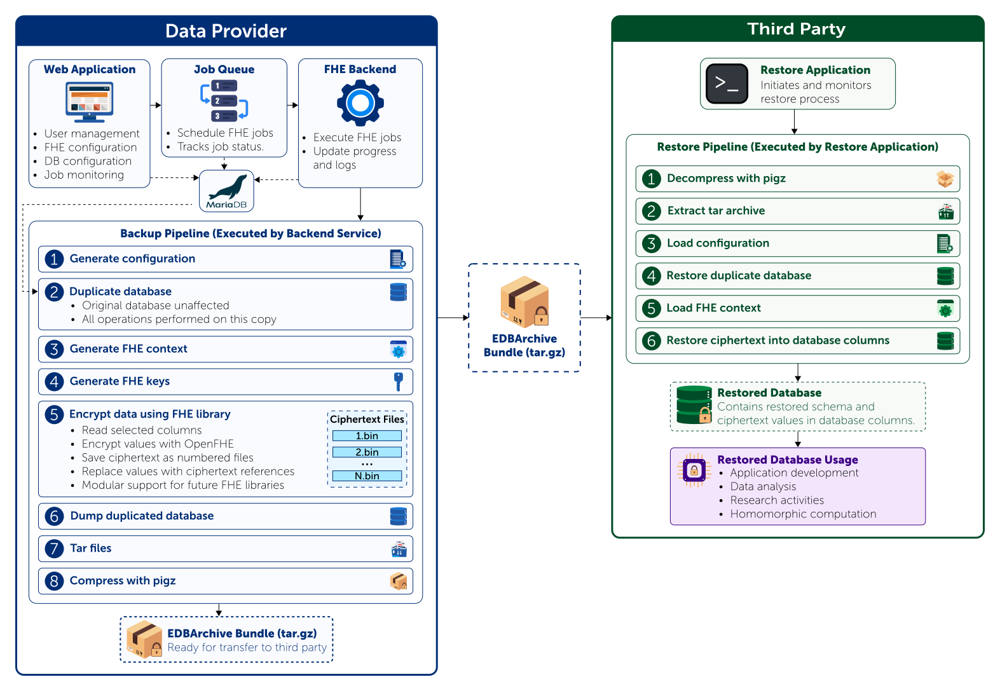

# System Architecture

EDBArchive separates interactive configuration from the database and
cryptographic operations that may take a significant amount of time. The
data-provider components run as a coordinated stack, while restoration is
performed by a standalone third-party command.

## Architecture overview



The management application records configuration and submits work, but it does
not perform FHE operations directly. A Python worker claims queued jobs and
delegates them to a backend selected from the configured FHE library and
scheme. Backup artifacts are exchanged between the web application and worker
through shared storage.

The restoration path is intentionally separate from the provider-side job
queue. A recipient runs the third-party CLI with a generated bundle and the
connection details of a target MariaDB instance.

## Implementation Status and Backend Extensibility

EDBArchive separates reusable orchestration from FHE-specific implementations.
A capability identified as a backend extension point is not necessarily
included as an executable implementation in the current artifact.

The architecture has two separate FHE backend boundaries:

1. the data-provider backend creates cryptographic resources and encrypted
   backup bundles; and
2. the third-party backend consumes a bundle and restores its protected values.

Both sides use the same `<library_name>_<scheme_name>` backend identity, but
they are separate executables with different arguments and responsibilities.

| Capability | Status | Notes |
|---|---|---|
| Web-based metadata, database, and share management | Implemented | Provided by the Laravel application |
| Asynchronous FHE job processing | Implemented | Supports context, key-pair, and backup jobs |
| Provider-side database preparation and bundle creation | Implemented | Reusable orchestration around the selected provider executable |
| Third-party bundle extraction and database import | Implemented | Reusable orchestration around the selected restoration executable |
| Language-independent executable dispatch | Implemented | Both wrappers invoke external executable files |
| Backend selection using `<library_name>_<scheme_name>` | Implemented | Used independently on the provider and third-party sides |
| OpenFHE 1.4.0 with BFV | Implemented and evaluated | Includes a compatible provider and restoration executable pair |
| EDBArchive SIMD packing for OpenFHE BFV | Implemented and evaluated | Used by the current executable pair |
| Additional FHE libraries or schemes | Backend extension point | Requires a new compatible provider and restoration executable pair |
| Alternative packing methods as production backends | Backend extension point | The benchmark implementations are standalone comparisons, not registered production backends |
| Multiple libraries, schemes, contexts, or key pairs in one bundle | Not supported | Each bundle currently uses one compatible FHE configuration |

The current repository therefore provides one complete backend pair: OpenFHE
1.4.0 with BFV. References to other libraries, schemes, or packing strategies
describe extension points in the architecture, not other working backends
included in the artifact.

## Data-provider components

### Management web application

The Laravel application provides the user interface and stores the metadata
needed to define a backup. Its responsibilities include:

- managing users, FHE libraries, and schemes.
- defining FHE contexts and key registries.
- registering source databases, tables, and columns.
- selecting plaintext or FHE protection for shared columns.
- creating context-generation, key-generation, and backup jobs.
- displaying job status and the SHA-256 hash of a completed bundle.
- serving completed bundles for download.

The web application stores its state in MariaDB. When it creates a job, it also
sends a `WAKE` message to the Python worker so that the worker can inspect the
queue immediately.

### Configuration scope and reuse

The management records do not all have the same lifecycle. Cryptographic and
database definitions are system-wide resources that can be reused, while a
share represents one delivery configuration and its generated bundle.

| Resource | Scope and lifecycle |
|---|---|
| Library | System-wide backend definition shared by compatible schemes and contexts |
| Scheme | System-wide parameter definition used to create contexts |
| FHE context | Generated artifact reusable by multiple compatible keys and shares |
| FHE key | Reusable by shares with the same recipient and context while its lifecycle remains appropriate |
| Database configuration | Reusable template containing selected tables, columns, and protection defaults |
| Share | Per-delivery selection of owner, recipient, database content, context, and key |
| Bundle | Immutable output generated for one share |

Database protection settings are defaults rather than live references for
existing share items. When configured columns are added to a share, the web
application copies those defaults into per-share records. Changing the
database template later does not update existing share items or an already
generated bundle.

Consequently, a provider normally configures libraries, schemes, contexts,
keys, and database templates once and reuses them. Creating another bundle
usually requires only a new share, review of its copied column settings, and a
new backup job.

### Python job worker

The job worker separates HTTP requests from long-running backend operations.
It supports three job types:

| Job type | Purpose |
|---|---|
| `create-context` | Generate and serialize an FHE context |
| `create-keypair` | Generate and serialize a public/private key pair |
| `backup` | Create an encrypted database backup bundle |

Jobs are claimed from the `fhe_jobs` table in creation order. The worker writes
the job input to shared storage, invokes the backend wrapper, captures its
structured result and logs, and updates both the job and related domain record.

The worker can be triggered by `WAKE`, but it also polls periodically. The TCP
listener additionally provides the `HEALTH` command used by the container
health check.

### Backend wrapper

The Bash wrapper prepares each job and chooses the executable using this naming
convention:

```text
<library_name>_<scheme_name>
```

For the current implementation, the resolved backend is:

```text
openfhe_bfv
```

This dispatch convention allows another backend executable to be added without
embedding a fixed implementation name in the web application or worker. The
artifact currently includes only the OpenFHE BFV backend.

For a backup job, the wrapper also duplicates the selected source database,
removes unselected tables and columns from the duplicate, exports the processed
database, creates the archive, and removes the temporary database.

### Backend extension model

The integration boundary is process-based rather than
programming-language-specific. `fhe_wrapper.sh` and `third_party.sh` invoke
external executables and do not depend on the language or framework used to
implement them. A backend may therefore be written in C++, Rust, Python, or
another language, provided that its executable:

1. is available inside the corresponding runtime;
2. accepts the command-line arguments defined for that side of the workflow;
3. reads the expected configuration and artifact formats;
4. produces the expected artifacts or database transformation;
5. follows the defined exit-code behavior; and
6. is named `<library_name>_<scheme_name>` using the normalized library and
   scheme identity.

The two executable contracts are distinct:

| Side | Runtime executable | Responsibility |
|---|---|---|
| Data provider | `bin/<library_name>_<scheme_name>` | Create contexts and key pairs, and transform selected values into an encrypted backup |
| Third party | `<third-party-bin>/<library_name>_<scheme_name>` | Interpret bundle artifacts and restore protected values in the target database |

The provider and restoration executables must agree on the bundle metadata and
cryptographic artifact formats, but they do not share the same command-line
interface. The provider executable receives a workspace, job identifier, and
database configuration. The restoration executable receives an extracted
bundle directory, target database name, and database configuration.

Replacing a backend does not require changes to the surrounding EDBArchive
orchestration, provided that both executables satisfy their respective
contracts. Metadata management, job scheduling, source-database preparation,
bundle creation, extraction, database import, cleanup, and execution reporting
remain handled by the existing system.

Backend integration consists of two steps:

1. **Deployment:** provide compatible provider-side and third-party
   executables in their respective runtime locations. The executables must be
   included in the native or container build used for deployment.
2. **Registration:** add the library, scheme, and scheme-parameter metadata
   through the web interface.

After the executables have been deployed, the backend can be selected through
the web interface without modifying the Laravel application, Python worker, or
wrapper dispatch logic. Registering metadata alone does not install an
executable, selecting an undeployed backend produces a backend-not-found error.

Custom artifact formats may extend `config.json`, but the top-level FHE library
and scheme identity must remain available so that the third-party wrapper can
select the corresponding restoration executable.

#### Reusing the C++ definitions

The executable boundary is language-independent, but the repository provides
reusable definitions and reference implementations for researchers who choose
C++:

```text
backend/common/edbarchive.hpp              Provider-side definitions
backend/common/json.hpp                    Provider-side JSON support
backend/openfhe_bfv/openfhe_bfv.cpp        Provider reference implementation
third-party/common/edbarchive.hpp          Restoration-side definitions
third-party/common/json.hpp                Restoration-side JSON support
third-party/openfhe_bfv/openfhe_bfv.cpp    Restoration reference implementation
```

The common headers define conventions such as backend arguments, artifact
names, commands where applicable, and exit codes. The two headers are separate
because the provider and restoration executables have different contracts.
The OpenFHE BFV sources may be used as reference implementations or starting
points for another C++ backend.

These files are shared definitions and examples rather than a complete
abstract C++ SDK. Their reuse is optional. A backend written in another
language remains compatible when it implements the same external command-line,
configuration, artifact, and exit-code contracts.

Extensibility applies across backend implementations and bundles. It does not
allow multiple FHE configurations to be mixed inside one bundle. All protected
columns in a bundle must currently use:

- one FHE library and scheme
- one FHE context
- one FHE key pair

For example, a single bundle cannot combine columns protected with BFV and BGV.
The web bundle-generation flow limits a share to one FHE key, and the provider
backend additionally rejects jobs containing different context or key-pair
references. Because each context belongs to one scheme, this also restricts the
bundle to a single scheme. Support for another scheme would therefore produce a
separate bundle using the matching provider and restoration executables.

### OpenFHE BFV backend

The C++ backend performs the provider-side FHE operations. It generates contexts and key pairs and, during backup creation, performs the following steps:

1. loads the selected context and key pair.
2. generates the evaluation keys required by the artifact.
3. reads protected integer values in primary-key order.
4. packs values into BFV plaintext slots.
5. encrypts each packed plaintext.
6. serializes each ciphertext as a binary file.
7. replaces protected values in the duplicated database with ciphertext-file references.

The source database is not modified by this process. All transformations are
applied to the temporary duplicate created for the job.

### MariaDB

The MariaDB service has two roles in the data-provider stack:

- it stores Laravel metadata and the persistent FHE job queue.
- it hosts the source database and temporary duplicate used during backup.

The Docker environment initializes a TPCC database for reproduction. MariaDB
initialization scripts run only when its data volume is empty. The Laravel
seeder registers the reproducibility metadata and queues one context job, one
key-pair job, and two backup jobs; the worker then generates both seeded
bundles in dependency order.

### Shared artifact storage

The web application and job worker mount the same named volume at different
container paths:

| Component | Mount path |
|---|---|
| Web application | `/var/www/html/storage/app` |
| Job worker | `/app/storage` |

Important locations within the volume include:

```text
fhe-jobs/<job-id>/   Job input, result, and execution files
private/<job-id>/    Context and key-pair artifacts
public/<job-id>/     Generated public backup bundle
```

The runtime database credential file used by the worker is not stored in this
persistent volume. It is generated under `/run/edbarchive`, which is mounted as
a temporary in-memory filesystem by Compose.

## Provider-side backup workflow

A backup moves through the following stages:

1. The web application validates the share and records a pending backup job.
2. The worker claims the job and writes its configuration to shared storage.
3. The wrapper creates a temporary copy of the source database.
4. Tables and columns not selected by the share are removed from the copy.
5. The OpenFHE backend packs and encrypts protected column values.
6. The transformed database is exported to `dump.sql`.
7. The dump, ciphertexts, FHE artifacts, and restoration metadata are archived
   and compressed as `bundle.tar.gz`.
8. The temporary database and intermediate public files are removed.
9. The worker calculates the SHA-256 hash of the completed bundle and stores
   the hash and bundle reference in the application database.

Ciphertexts remain separate binary files in the transferable archive. The SQL
dump contains numeric references that associate protected rows with those
files. This representation avoids storing the packed backup ciphertexts as
database BLOBs before the bundle is transferred.

## Bundle structure

A generated bundle has the following logical structure:

```text
bundle.tar.gz
├── config.json
├── context.bin
├── relinearization.bin
├── rotation.bin
├── dump.sql
└── ciphertexts/
    ├── 1.bin
    ├── 2.bin
    └── ...
```

`config.json` identifies the FHE backend and records the tables, primary keys,
and protected columns required during restoration. `dump.sql` contains the
selected plaintext data and ciphertext references. The `ciphertexts` directory
contains the packed and serialized OpenFHE ciphertexts.

Neither the private key (`private.bin`) nor the public key (`public.bin`) is
included in the bundle. The third party receives the FHE context, evaluation
material, and existing ciphertexts required for restoration and subsequent
homomorphic evaluation, but not the encryption or decryption keys.

Using the bundle contents alone, the third party therefore cannot decrypt the
protected values or encrypt new plaintext values. It can deserialize the
restored ciphertexts and perform homomorphic operations supported by the
included context and evaluation keys. The bundle's SHA-256 hash is stored in
EDBArchive application metadata after bundle creation, it is not embedded
inside the archive.

## Third-party restoration

Restoration is performed outside the data-provider services. The third-party
CLI receives:

- the path to `bundle.tar.gz`
- a new target database name
- a `db.json` file containing the target MariaDB connection details

The restoration workflow is:

1. verify the command arguments and database configuration.
2. ensure that the requested target database does not already exist.
3. decompress and extract the bundle into a temporary directory.
4. validate the FHE identity and reconstruction metadata in `config.json`.
5. create the target database and import `dump.sql`.
6. load the OpenFHE context, rotation key, and packed ciphertext files.
7. rotate each packed ciphertext to align the required slot.
8. serialize the resulting per-record ciphertext and store it in a MariaDB
   `MEDIUMBLOB` column.
9. remove the plaintext ciphertext-reference column and replace it with the
   serialized ciphertext column.
10. remove temporary extraction files.

If restoration fails after creating the target database, the wrapper removes
the partially transformed database so that the operation can be retried.

Protected values are not decrypted during restoration. MariaDB stores binary
OpenFHE ciphertext serialization; an application that performs subsequent
homomorphic computation must read and deserialize those bytes as OpenFHE
ciphertexts.

## Container topology

| Service | Network exposure | Persistent storage |
|---|---|---|
| `web` | Host loopback port `8000` by default | Shared EDBArchive storage |
| `job-queue` | Port `9100` on the Compose network | Shared EDBArchive storage |
| `mariadb` | Host loopback port `3307`, port `3306` internally | MariaDB data volume |
| `third-party` | CLI, no listening port | Input files mounted at runtime |

The web application reaches the worker at `job-queue:9100`. Both the web
application and worker reach MariaDB at `mariadb:3306`. Host port mappings are
used only for browser access and optional host-side database inspection.

## Current implementation boundaries

The architecture is extensible, but the published implementation currently has
the following boundaries:

- OpenFHE is the only FHE library implementation.
- BFV is the only implemented scheme.
- protected columns must contain integer values.
- primary-key columns must be included and remain plaintext.
- all protected columns in a bundle use one library, one scheme, one FHE
  context, and one key pair.
- schemes such as BFV and BGV cannot be combined in the same bundle.
- packed ciphertexts are reconstructed as serialized `MEDIUMBLOB` values.
- restoration is a standalone CLI operation, not a provider-side queue job.

## Next steps

- Continue with [Installation and Setup](installation.md) to build and start
  EDBArchive.
- Return to the [documentation index](index.md).
